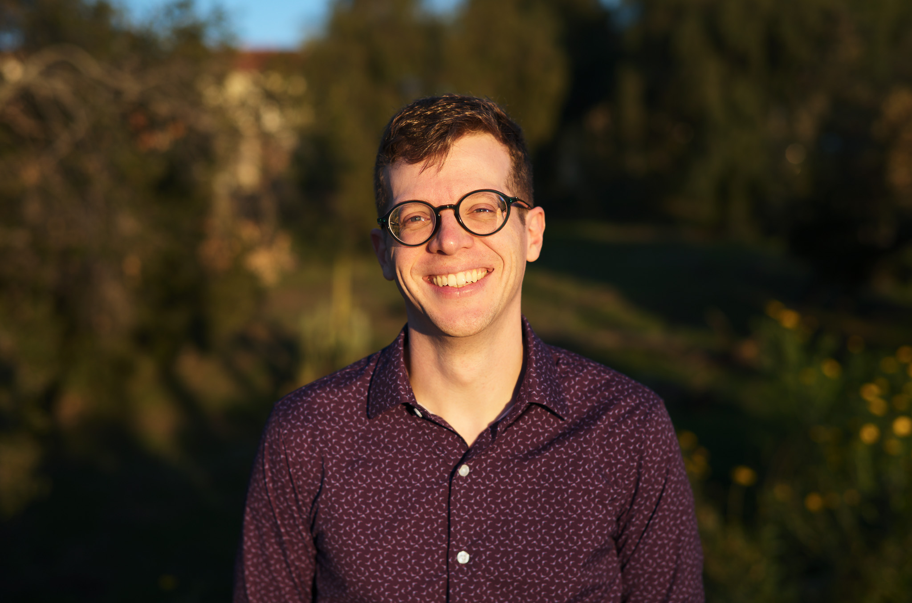

## About me

I am Assistant Professor of Political Science at Trinity College in Hartford, Connecticut. I teach courses on Chinese politics, US-China relations, and research methods.

::: column-margin

:::

I received my Ph.D. in Political Science at the University of Michigan, where I also received an MA in Chinese Studies. From 2023 to 2025, I served as a Postdoctoral Scholar at the UC San Diego School of Global Policy and Strategy's 21st Century China Center.

When I am not on campus, I can be found walking my rescued racing greyhounds, writing blog posts I will forget to publish, and hunting for rare[^1] books.

[^1]: If you ever suffer the misfortune of hearing about my book collection, you will quickly discover the difference between 'rare' and 'valuable.'

## About my work

Generally, my research focuses on bureaucracy and the evolution of administrative-legal institutions. I also have methodological interests in the analysis of text and in mixed-methods social science. Empirically, I am interested in the cases of China under the Communist Party of China and martial-law era Taiwan.

You can read more specifics about my research and teaching by clicking the tabs above.
